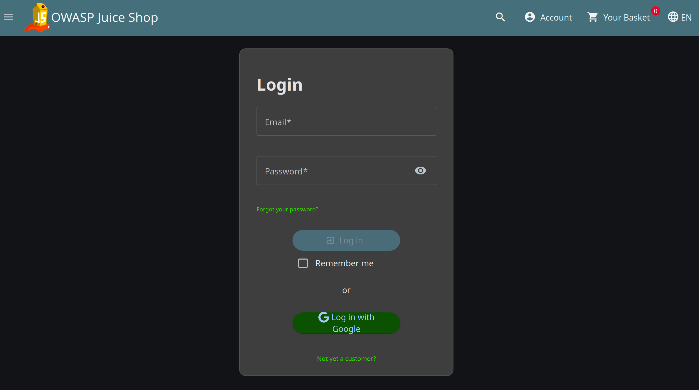
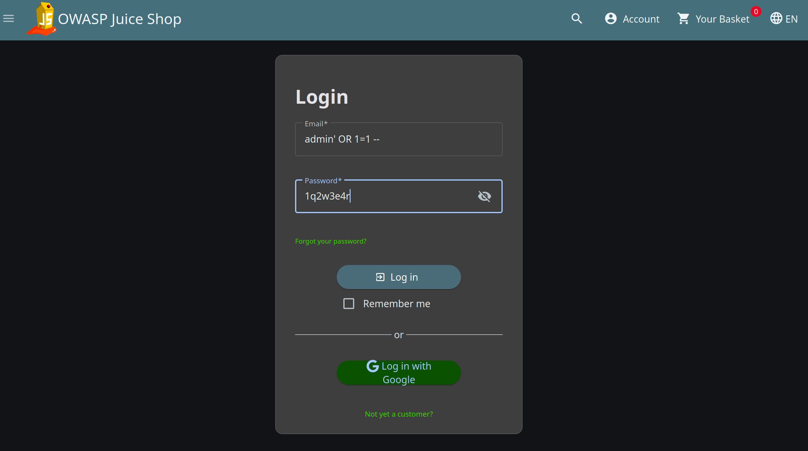
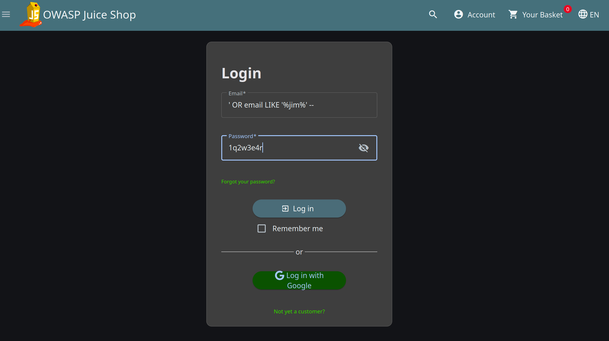

# Security Requirements Document (SRD) & Security Response Plan (SRP)
## Case Study: Authentication Bypass via SQL Injection (SQLi) Remediation

> **DISCLAIMER & ETHICAL STATEMENT**  
> This project is a security analysis study, risk governance framework mapping, and security requirements engineering exercise (GRC Documentation) using **OWASP Juice Shop** (a locally hosted lab environment intentionally designed for educational purposes). This document does not represent security testing conducted on unauthorized or commercial enterprise systems.

---

## 1. Executive Summary

This document outlines the technical security evaluation, risk assessment, **Security Requirements Document (SRD)**, and **Security Response Plan (SRP)** addressing an identified SQL Injection (SQLi) vulnerability within the OWASP Juice Shop authentication endpoint (`/api/Users/login`).

The primary objective of this documentation is to deliver structured engineering requirements for secure database interaction and establish actionable incident response procedures for Security Operations Center (SOC) personnel, specifically contrasting the blast radius between administrative account takeover and targeted user account hijacking.

---

## 2. Risk & Impact Analysis & Risk Treatment Plan

| Parameter | Initial Assessment (Pre-Mitigation) | Post-Mitigation (Residual Risk) |
| :--- | :--- | :--- |
| **Vulnerability** | SQL Injection - Authentication Bypass (CWE-89) | Remediated / Neutralized |
| **CVSS v3.1 Score** | **9.8 (CRITICAL)** (`CVSS:3.1/AV:N/AC:L/PR:N/UI:N/S:U/C:H/I:H/A:H`) | **0.0 (NONE)** |
| **Risk Treatment Strategy** | N/A | **Risk Reduction (Mitigation)** |
| **Risk Owner** | Lead Backend Engineer / Database Administrator | Head of Information Security (Sign-off) |
| **Remediation SLA** | **24 to 48 Hours** (Critical Severity Standard) | Verified & Closed |

### 2.1 Residual Risk Justification
By enforcing parameterized queries (Prepared Statements) and Object-Relational Mapping (ORM) data binding, user-supplied input is strictly separated from SQL execution logic. The database driver treats input strictly as literal values rather than executable code, completely neutralizing the attack vector and reducing exploitability to zero.

---

## 3. Compliance Framework Mapping

| Standard Framework | Control ID & Name | Strategic Alignment Description |
| :--- | :--- | :--- |
| **ISO/IEC 27001:2022** | **Annex A.8.28** (Secure Coding) | Mandates secure coding practices to eliminate injection flaws during database query construction. |
| **ISO/IEC 27001:2022** | **Annex A.8.8** (Management of Technical Vulnerabilities) | Establishes immediate patching and lifecycle workflows for critical system vulnerabilities. |
| **NIST CSF v2.0** | **PR.DS-01** (Data Security) | Enforces protective mechanisms to safeguard database confidentiality, integrity, and access controls. |
| **NIST CSF v2.0** | **DE.CM-01** (Continuous Monitoring) | Requires continuous monitoring of database logs for anomalous query syntax patterns. |

---

## 4. Proof of Concept (PoC) & Execution Evidence

1. **Vulnerability Mechanics**: User inputs supplied to the `email` field are directly concatenated into backend SQL query strings without prior validation or parameter binding. This allows attackers to break out of string literals and alter the SQL query logic.

2. **Exploitation Impact Comparison**:

   * **Scenario A: Administrative Account Takeover (Highest Impact / Privilege Escalation)**
     * **Payload**: `admin' OR 1=1 --`
     * **Mechanism**: Force-evaluates the query boolean condition to `TRUE` for the administrative user record, ignoring password verification via the comment operator (`--`).
     * **Impact**: Grants full administrative rights over the tenant application, system configuration, and user database.

   * **Scenario B: Targeted Specific User Hijacking (Arbitrary User Impersonation)**
     * **Payload**: `' OR email LIKE '%jim%' --`
     * **Mechanism**: Leverages SQL pattern matching (`LIKE`) to bypass password checks and authenticate as a specific targeted user identity (e.g., User 'Jim').
     * **Impact**: Enables targeted horizontal privilege escalation, data theft, and unauthorized actions under a specific victim's identity.

3. **Execution Evidence (Embedded Visuals)**:

   * **Baseline State (Normal Login Application)**:  
     

   * **Exploited State A (Admin Account Takeover via `admin' OR 1=1 --`)**:  
     

   * **Exploited State B (Targeted User Hijacking via `' OR email LIKE '%jim%' --`)**:  
     

---

## 5. Security Requirements Document (SRD) & Technical Remediation

Engineering teams must adhere to the following technical security specifications and code implementation standards:

### 5.1 Security Acceptance Criteria
* **SR-01 (Mandatory Query Parameterization)**: Developers shall never concatenate raw user input directly into SQL statement strings. All database access logic must use parameterized queries or safe ORM methods.
* **SR-02 (Input Validation & Formatting)**: Enforce strict format checks on authentication parameters (e.g., valid RFC 5322 email regex constraints) before passing data to data access layers.
* **SR-03 (Least Privilege Database Account)**: The database user account utilized by the application backend must operate under strict least-privilege principles, lacking administrative privileges over the underlying database engine.

### 5.2 Technical Code Remediation Snippets
#### A. Vulnerable Code Pattern (Current State)
```javascript
// UNSAFE: Directly concatenating raw user inputs into SQL query string
const query = "SELECT * FROM Users WHERE email = '" + req.body.email + "' AND password = '" + req.body.password + "'";
db.query(query, (err, results) => {
    // Processes authentication logic
});

// SECURE: Using parameterized queries where inputs are treated strictly as data parameters
const query = 'SELECT * FROM Users WHERE email = ? AND password = ?';
db.query(query, [req.body.email, req.body.password], (err, results) => {
    // Safely evaluates user parameters without query logic manipulation
});

// SECURE (Alternative): Using ORM (Sequelize) parameter binding
models.User.findOne({
    where: {
        email: req.body.email,
        password: req.body.password
    }
});
```
### 5.3 Automated Security Controls (CI/CD Pipeline Integration)

To prevent regression of SQL Injection vulnerabilities (CWE-89) and enforce proactive security controls aligned with **NIST CSF v2.0 PR.PS-01 (Software Security)** and **ISO/IEC 27001:2022 Annex A.8.28 (Secure Coding)**, the engineering organization must integrate automated security checks directly into the GitHub Actions CI/CD deployment pipeline.

---

#### 1. Static Application Security Testing (SAST) Integration

Mandatory static code analysis tools (e.g., SonarQube, Semgrep, or ESLint Security Plugins) must be executed automatically upon every `pull_request` and `push` targeting the `main` or `release` branches.

#### Rule Enforcement Specifications
1. **Detection of Raw Query String Concatenations**: AST-based (Abstract Syntax Tree) linter rules must scan all backend database access files (`/routes`, `/controllers`, `/services`) for raw SQL string concatenation constructs (e.g., `db.query("... " + input)`).
2. **Mandatory Parameterization Flag**: Scanners must verify that database queries utilize binding parameters (`?`, `$1`) or safe ORM abstraction methods (e.g., Sequelize / Prisma methods).

---

#### 2. GitHub Actions Security Pipeline Configuration

The following automated pipeline workflow file must be placed in `.github/workflows/security-sast.yml`:

```yaml
name: Security Scan - SAST Pipeline

on:
  push:
    branches: [ "main", "develop" ]
  pull_request:
    branches: [ "main" ]

jobs:
  sast_scan:
    name: Run SAST & Security Linting
    runs-on: ubuntu-latest

    steps:
      - name: Checkout Code
        uses: actions/checkout@v4

      - name: Setup Node.js Environment
        uses: actions/setup-node@v4
        with:
          node-version: '18'

      - name: Install Dependencies
        run: npm ci

      - name: Run Semgrep SAST Analysis (SQLi Check)
        uses: returntocorp/semgrep-action@v1
        with:
          config: p/sql-injection
        env:
          SEMGREP_APP_TOKEN: ${{ secrets.SEMGREP_APP_TOKEN }}

      - name: Run Security Linter Check
        run: npx eslint --config .eslintrc-security.json "server/**/*.js"
```

#### 3. Automated Quality Gates & Build Failure Triggers

To enforce non-negotiable security boundaries before code reaches production environments:
* **Automatic Build Rejection**: Any Pull Request introducing raw SQL string concatenation or unescaped user input queries will automatically fail the pipeline execution.
* **Pull Request Merge Blocking**: GitHub repository settings must enforce Branch Protection Rules requiring a passing sast_scan status check prior to merging code into protected branches.
* **Notification Routing**: Pipeline failure alerts detailing the exact file name and line number of the SQLi vector must be routed immediately to the #devsecops-alerts Slack channel and the assigned Lead Backend Engineer

---

# 6. Security Response Plan (SRP) - Operational Incident Handling Procedures

When a potential SQL Injection (SQLi) exploitation incident targeting the authentication endpoint (`/api/Users/login`) is detected by Security Operations Center (SOC) monitoring systems, the following operational Incident Response Workflow must be executed by the Incident Response Team (IRT).

---

## Phase 1: Triage & Identification

1. **Log Analysis & Pattern Matching**: 
   Query Web Application Firewall (WAF) logs, NGINX access logs, and database engine query logs for anomalous SQL syntax patterns targeting authentication routes:
   * **Admin Takeover Indicators**: Requests containing boolean condition overrides (e.g., `admin' OR 1=1 --`, `OR '1'='1`).
   * **Targeted User Hijacking Indicators**: Requests containing wildcard pattern matching or specific user probes (e.g., `' OR email LIKE '%jim%' --`).
2. **Blast Radius & Impact Assessment**:
   * Determine if unauthorized administrative session tokens (`JWT`, session cookies) were generated during the activity window.
   * Verify if the breach involved horizontal privilege escalation (user account hijacking) or vertical administrative takeover.

---

## Phase 2: Containment (Isolation)

1. **WAF Emergency Rule Deployment**:
   Immediately deploy a temporary Web Application Firewall (WAF) regex blocking rule on the `/api/Users/login` path to intercept malicious payloads at the edge:

   ```regex
   (?i)(or\s+1=1|--|union\s+select|like\s+'%|[';])
   ```
2. **Session Revocation & Credential Isolation**:
   * Issue an automated session invalidation command to terminate all active administrative and user JWT session tokens generated during the breach window.
   * Force mandatory re-authentication for any accounts accessed via suspected SQLi payloads within the affected timeframe.

---

## Phase 3: Eradication & Recovery
1. **Patch Deployment (Parameterized Query Enforce)**:
   * Perform emergency code review and merge the secure code patch utilizing Prepared Statements / ORM parameter binding (as specified in SR-01) directly to production.
2. **Database Integrity Verification**:
   * Audit database user tables, role assignments, and access control records to verify that no backdoors or secondary administrative accounts were injected during the exploit.
3. **Recovery Validation**:
   * Conduct regression testing against the /api/Users/login endpoint using automated PoC test scripts to ensure authentication functionality is fully restored without security regression.

---

## Phase 4: Post-Incident Activity (Lessons Learned)
1. **Root Cause Analysis (RCA)**:
Conduct a formal post-mortem review within 5 business days to determine why raw SQL query concatenation bypassed code review mechanisms and SAST pipeline checks.
2. **Policy Offloading**:
Verify code structural integrity in production, confirm zero residual SQLi anomalies over a 48-hour window, and gracefully offload the temporary WAF emergency regex blocking rules.
3. **Enterprise Risk Register Update**:
Record the incident timeline, root cause, CVSS severity (**9.8 CRITICAL**), and business impact in the Enterprise Risk Register (mapped to ISO/IEC 27001:2022 Annex A.8.8).
4. **Governance & Exception Policy**:
If the engineering team cannot meet the 24-to-48 Hour Remediation SLA due to critical production blockers, a formal Risk Acceptance / Exception Request must be submitted to the Risk Committee. The temporary emergency WAF blocking rule will remain active as a Compensating Control subject to daily review by the Head of Information Security.

## About the Author
Ex-Product Manager pivoting into Governance, Risk, and Compliance (GRC). This repository demonstrates the practical application of technical vulnerability research mapped directly to enterprise security controls and compliance frameworks (ISO/IEC 27001 & NIST CSF).
